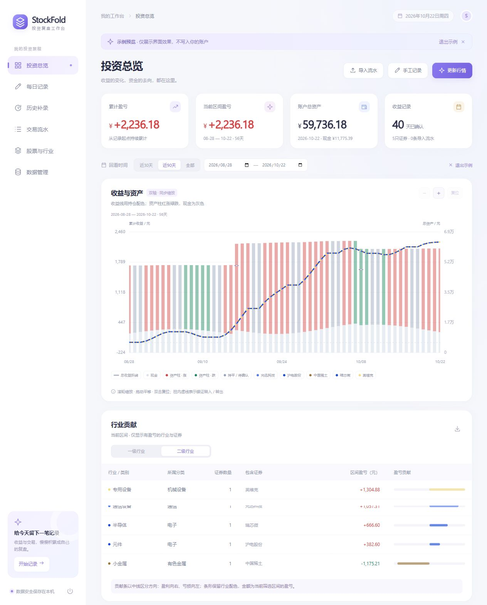

# StockFold

一个在本机运行的股票收益复盘工作台。导入交易流水，结合历史收盘价还原每日收益、持仓市值与现金变化，用一张图回看投资过程。

Python 标准库后端 · SQLite 本地存储 · 原生 JavaScript 前端 · 无需前端构建



> 截图使用程序生成的示例数据。仓库不包含个人账单、账户数据库或真实收益截图。

## 可以做什么

- **导入交易流水**：读取普通资金流水 Excel，预览明细、检查重复及合计差异，再确认导入；保留原始字段，支持后续核对。
- **自动还原收益**：按期初持仓、买卖净额、红利及费用，结合股票 / ETF 的不复权历史收盘价计算每日盈亏。
- **收益与资产合并图**：总收益折线和现金 / 持仓资产柱共用日期轴，分别使用左右金额轴。
- **持仓配色与涨跌配色**：总收益线按当天收盘持仓市值比例显示股票颜色；资产柱的持仓部分红涨绿跌、持平或待确认时灰色，现金始终为灰色。
- **鼠标缩放与平移**：滚轮围绕指针位置缩放，拖动平移，双击或点击“复位”恢复范围；也支持加减按钮。
- **行业贡献表**：按一级 / 二级行业汇总区间盈亏，展示证券名单、数量和贡献条；自动隐藏当前区间盈亏为零的行业与股票。
- **分类与配色维护**：内置行业目录、证券分类及 31 个一级行业的配色方案；ETF 单独分类，支持手动调整。
- **核对与备份**：支持手工校准、账户快照、资金转入转出标记、SQLite 备份恢复、JSON / CSV 导出。
- **每日手动录入**：个股当日收益支持直接输入完整名称或代码，输入部分名称或代码可搜索已有股票及内置证券目录；无需先录入买入流水。目录外证券可展开“手动录入”补填名称、代码、市场与类型。

## 快速开始

### 环境

- Python **3.12 或更新版本**。
- 现代浏览器。
- 首次同步行情需要联网；已保存的账户数据和行情缓存可在本机查看。

运行程序只使用 Python 标准库，**不需要 `pip install` 或 `npm install`**。Node.js 仅用于运行前端测试。

### 下载并运行

```bash
git clone https://github.com/kikuheartbeat/StockFold.git
cd StockFold
python -m app.server
```

程序会启动仅监听 `127.0.0.1` 的本机服务，并自动打开浏览器。默认分配可用端口，终端中会输出访问地址。

Windows 用户安装 Python 后，也可以直接双击 **`启动.cmd`**。如果启动器没有找到 Python，可设置环境变量 `STOCKFOLD_PYTHON` 为 `python.exe` 的完整路径。

常用启动选项：

```bash
# 固定端口，不自动打开浏览器
python -m app.server --port 50875 --no-browser

# 将数据保存到指定目录
python -m app.server --data-dir ./my-data
```

自定义数据目录请放在仓库外，或将其加入 `.gitignore`。

关闭浏览器不会结束后台服务；可点击页面左下角电源按钮退出。重复启动默认数据目录时，会复用已运行的实例。

## 第一次使用

1. 点击 **“导入流水”**，选择自己的普通资金流水 `.xlsx` 文件。支持原始 18 列格式，以及带行业标注的 20 列格式。
2. 检查导入预览、重复记录和合计提示，再确认导入。
3. 在 **“股票与行业”** 核对证券归属；必要时调整期初持仓和期初现金。
4. 点击 **“更新行情”**，选择还原日期，获取历史收盘价并计算。
5. 核对缺价、余额差异和其他资金事件，保存计算结果，然后回到 **“投资总览”**。

还没有准备流水时，可以点击 **“看看示例效果”**。示例只在页面内展示，不写入账户数据库。

支持的原始流水字段包括：发生日期、摘要、币种、证券代码、证券名称、成交股数、成交价格、成交金额、总发生金额、净发生金额、资金余额、证券余额、佣金、净佣金、印花税、过户费、利息单价及应计利息。

## 收益怎样计算

```text
个股当日收益
  = 当日收盘持仓市值 − 上日收盘持仓市值
    + 卖出净收款 − 买入总支出 + 相关红利及税款影响

账户总资产 = 现金余额 + 全部已确认持仓市值
```

- 使用交易的实际资金发生额，避免重复扣手续费。
- 银证转入转出作为独立资金事件，不计入投资收益。
- 利息等账户其他收益单列，未知资金事项及余额差异保留核对提示。
- 缺少价格或持仓依据时保留缺口，不用零代替未知收益。
- 自动还原只依据已录入流水；结束日期晚于最后一笔流水时，假设之后没有遗漏的新交易。
- 自动生成日期可以重新计算；手工编辑过的日期会受到保护，自动保存会跳过。保存还原结果前会自动备份。

行情模块使用腾讯公开日线的不复权收盘价，并在本机缓存。当天数据在北京时间 **16:30 后**允许更新。公开行情接口可能出现延迟或缺价，页面会提示核对；程序不连接券商账户，也不执行交易。

## 数据保存与隐私

首次启动会自动创建 `data/stockfold.sqlite3`。数据库保存交易流水、收益、账户快照、行情缓存、行业配置和变更记录，备份位于 `data/backups/`。

行情请求仅包含公开证券代码、市场和日期，不发送交易金额、账户余额或持仓数量。页面通过本机服务访问数据，写入请求校验本机会话。

`.gitignore` 已排除数据库、账单、导出文件、备份、个人账户截图和本地工作目录。导入自己的文件后，仍建议在提交前检查 `git status`，避免将自建数据目录上传。

## 项目结构

```text
StockFold/
├── app/
│   ├── server.py               # 本机 HTTP 服务与 API
│   ├── db.py                   # SQLite 结构与初始化
│   ├── importer.py             # Excel 流水读取与导入
│   ├── market.py               # 行情获取与缓存
│   ├── reconstruction.py       # 流水、持仓和收益还原
│   ├── reconstruction_jobs.py  # 后台行情任务
│   ├── analytics.py            # 区间统计与行业贡献
│   ├── holding_values.py       # 每日收盘持仓估值
│   └── static/                 # 页面、样式与交互图表
├── resources/                  # 行业目录、证券分类与色表
├── tests/                      # 通用测试
├── docs/                       # 使用说明与示例配图
├── 启动.cmd                    # Windows 启动入口
├── 启动.ps1
└── 使用说明.md
```

## 测试

后端测试只需要 Python 标准库：

```bash
python -m unittest discover -s tests -t .
```

前端测试需要 Node.js 18+：

```bash
node --test tests/*.test.mjs
# 或 npm test
```

服务与启动测试会创建临时数据库和本机监听端口，不修改正式账户数据。

## 更多说明

- [详细使用说明](使用说明.md)
- [自动行情与流水还原](docs/自动行情与流水还原使用说明.md)
- [一级行业 31 色方案](docs/一级行业31色方案.md)

当前面向单账户、普通股票 / ETF 的复盘场景；尚未提供收益率计算、多账户同步或券商自动交易功能。
